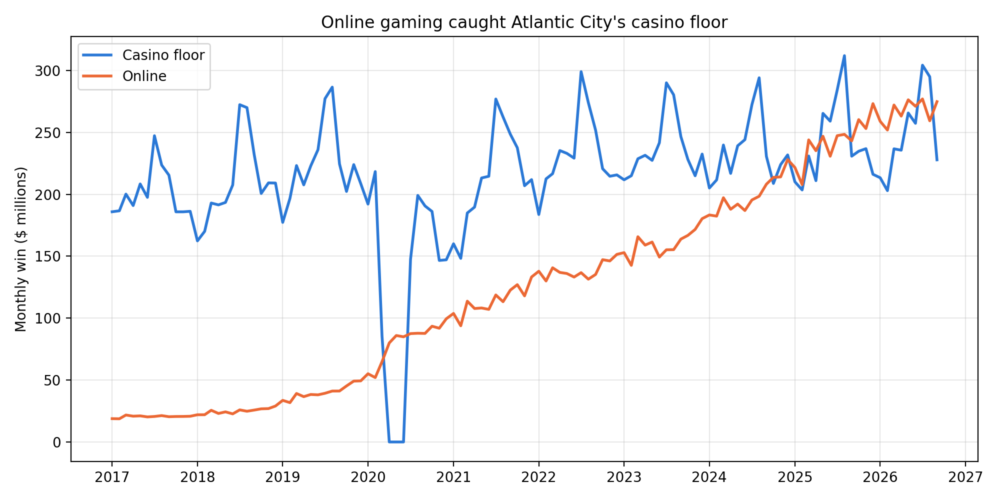

# Atlantic City Gaming Analysis

**Question:** 
Online gaming passed Atlantic City in 2025. When did it happen, why does the floor still win in summer, and which of the nine casinos are positioned for an online-first market?

**Data:** NJ Division of Gaming Enforcement monthly revenue reports, 2017 to present.

**Status:** In Progress.

## Findings

1. **Online passed the casino floor.** Online gaming first beat the casino floor in October 2024 and won the full year in 2025, $2.91B to $2.89B.
2. **COVID pushed players online, and they stayed.** Online win nearly doubled from $52M in February 2020 to $99.5M in December 2020, and it never fell back after the casinos reopened.
3. **The floor's summer is setting.** The floor beat online for four months in 2025 (May to August) and only two in 2026 (July and August). Its July and August lead fell from $100M to $63M.