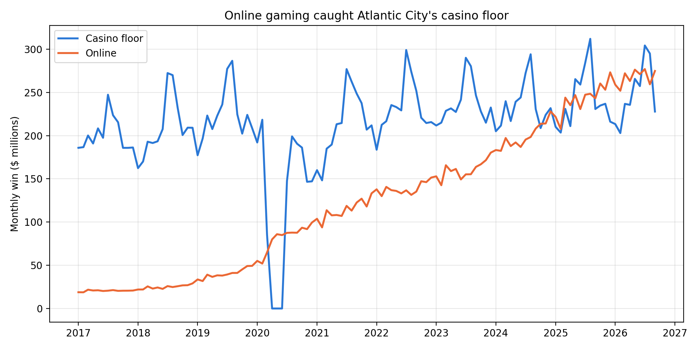
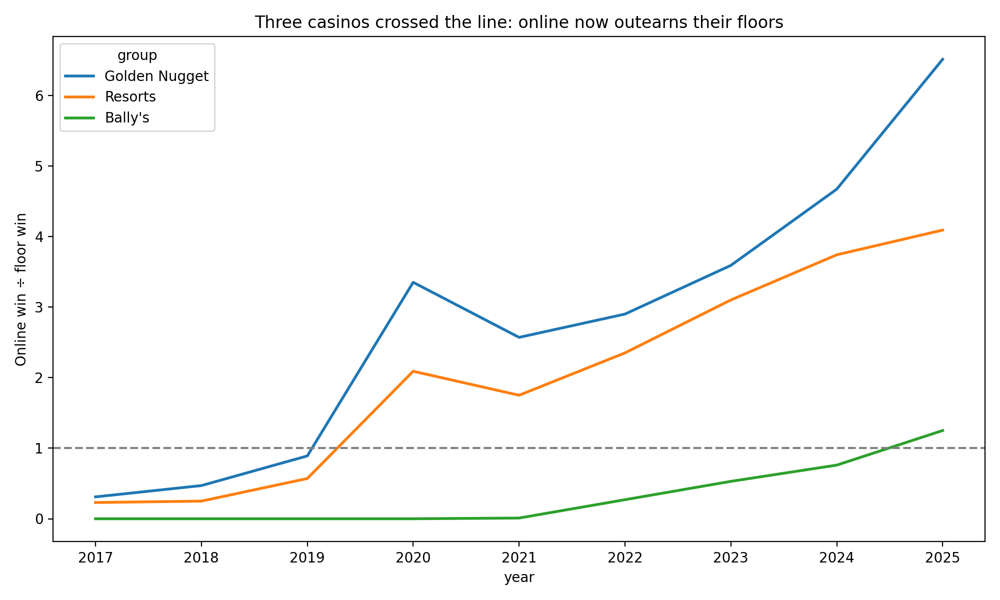
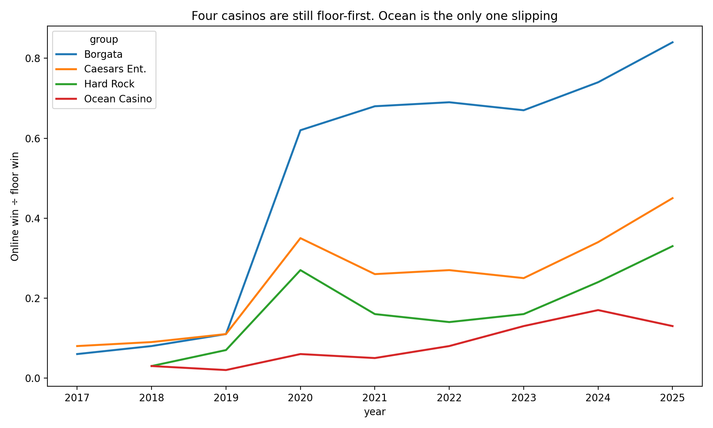

# Atlantic City Gaming Analysis

**Question:** 
Online gaming passed Atlantic City in 2025. When did it happen, why does the floor still win in summer, and which of the nine casinos are positioned for an online-first market?

**Data:** NJ Division of Gaming Enforcement monthly revenue reports, 2017 to present.

**Status:** Complete through September 2026.

## Findings

1. **Online passed the casino floor.** Online gaming first beat the casino floor in October 2024 and won the full year in 2025, $2.91B to $2.89B.
2. **COVID pushed players online, and they stayed.** Online win nearly doubled from $52M in February 2020 to $99.5M in December 2020, and it never fell back after the casinos reopened.
3. **The floor's summer is setting.** The floor beat online for four months in 2025 (May to August) and only two in 2026 (July and August). Its July and August lead fell from $100M to $63M.

## Which casinos are online-first?

4. **Half of online runs through two casinos.** For nine years, Golden Nugget and Resorts have carried about half of Atlantic City's online win, while their share of the city's floor win fell from 17% to 10%.
5. **Three casinos now win more online than on their floors.** Golden Nugget and Resorts crossed that line in 2020 and stayed above it after the floors reopened. Golden Nugget's online win grew from 0.31 times its floor in 2017 to 6.51 times in 2025. Bally's had no online win until 2021 and crossed the line in 2025, the fastest climb in the city.
6. **Ocean is the only casino moving the other way.** Its online win fell from 0.17 times its floor in 2024 to 0.13 in 2025, while every other casino rose. The brand data suggests part of the drop came from losing Parx, a partner brand that left Ocean's license in 2025.

## How it works

1. **Download:** `scripts/download_reports.py` pulls every monthly report from the NJ Division of Gaming Enforcement, January 2017 to September 2026 (117 PDFs).
2. **Statewide totals:** `scripts/extract_numbers.py` reads slot, table, casino, internet and sports win from each report into `data/clean/gaming_revenue.csv`. Every month passes a check: slot win + table win = casino win.
3. **Casino-level data:** `scripts/build_casino_data.py` reads each casino's floor win and online win into `data/clean/casino_monthly.csv`. The reports changed format in January 2025, so the script uses a different reader for each format. A name map handles 54 name variations over nine years (for example, "Bally's AC," "Ocean Resort," "GNOG").
4. **Validation:** every month's casino-level totals are checked against the statewide totals. Floor win matches in all 117 months. Online win matches in 114. Three months differ by $8, $10 and $452, because amounts under $1,000 are printed without commas and the parser skips them.
5. **Analysis:** `scripts/analyze_casinos.py` computes each casino's online-to-floor ratio by year and makes the charts.

**Notes on the data**
- "Online win" means win under a casino's license. Most of it is won on partner sites like FanDuel and DraftKings, and the casino keeps only a share.
- Caesars reports its online win under one license (Caesars Interactive NJ) for all its casinos, so Caesars, Harrah's and Tropicana are grouped as "Caesars Ent." Tropicana is included for all years, even though Caesars took it over in 2020.
- 2020 ratios are inflated by the COVID closure (March 16 to July 2), when floors earned nothing.
- 2026 covers January through September only.